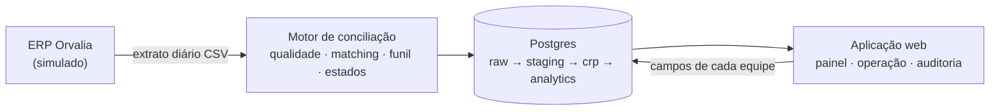

# pending-reconciliation

Motor de conciliação diária de repasses pendentes da **Orvalia Distribuição**, uma empresa fictícia, com banco de
dados e aplicação web para operar o processo de ponta a ponta. Tudo roda com **dados sintéticos**.

> **Situação:** em construção. Veja o [roteiro](docs/roadmap.md) e as issues.

## O problema

Todo dia o ERP da Orvalia exporta um extrato com cerca de 40 mil repasses. A Central de Repasses Pendentes (CRP)
precisa decidir o que é pendência nova de cada parceiro, atualizar as que já estão em acompanhamento, registrar
quando cada uma termina, arquivar as concluídas e separar as devolvidas, sem perder nenhum protocolo e com uma trilha
de auditoria. Antes, isso era feito em planilhas compartilhadas e macros manuais.

## A solução



- **Motor** em TypeScript: regras versionadas, simulação por padrão, idempotente, transacional.
- **Banco** Postgres em camadas, com histórico SCD2, auditoria antes/depois e permissões por coluna.
- **Aplicação** Next.js com personas (hub, Central, operador) e o Painel CRP.
- **Um mundo vivo:** o calendário fictício avança um dia útil por dia, via agendamento.

## Stack

TypeScript · Node.js 24 · Next.js · Drizzle · Postgres (PGlite no local e nos testes, Neon no ar) · Vitest ·
Playwright · GitHub Actions · Vercel

## Documentação

| Documento                                     | Conteúdo                                             |
| --------------------------------------------- | ---------------------------------------------------- |
| [Negócio da Orvalia](docs/negocio-orvalia.md) | Empresa, extrato e regras de negócio (RN-01…RN-11)   |
| [Modelo de dados](docs/modelo-de-dados.md)    | Schemas por camada, tabelas, restrições e permissões |
| [Telas](docs/telas.md)                        | Personas, telas e como o demo funciona no ar         |
| [Roteiro](docs/roadmap.md)                    | Etapas, critérios de pronto e marcos                 |
| [ADRs](docs/adr/)                             | Decisões de arquitetura                              |

## Como rodar

Requer Node.js 24 (veja `.nvmrc`). Não precisa instalar banco: o local usa Postgres embutido (PGlite).

```bash
npm install
npm run check       # format, lint, typecheck e testes, igual ao CI
npm run db:migrate  # cria o banco local em .pglite/ com o esquema atual
npm run dev         # aplicação web em http://localhost:3000
npm run build       # build de produção da aplicação, igual ao CI
```
