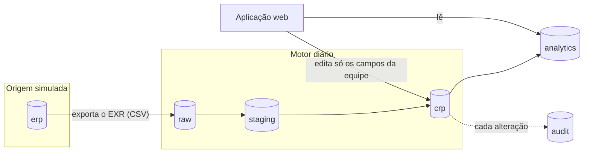
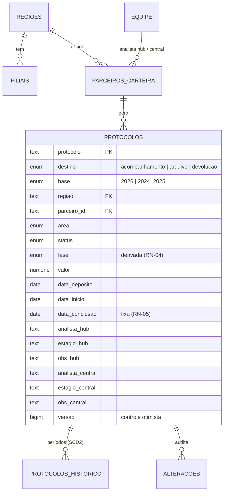

# Modelo de dados

Postgres em todos os ambientes (ADR-0002). O banco é dividido em **schemas por camada**, no caminho que o dado
percorre, do sistema de origem ao painel:

| Schema      | Papel                                                                   | Quem escreve                           |
| ----------- | ----------------------------------------------------------------------- | -------------------------------------- |
| `erp`       | O "ERP Orvalia": estado de todos os repasses e calendário fictício      | `synth`                                |
| `raw`       | O extrato do dia **como veio**: tudo texto, com o hash do arquivo       | motor (carga)                          |
| `staging`   | O extrato tipado e normalizado, com os problemas de qualidade por linha | motor                                  |
| `crp`       | O domínio da CRP: cadastro, protocolos e histórico                      | motor e aplicação (campos das equipes) |
| `audit`     | Execuções, funil, avisos e alterações                                   | motor e aplicação                      |
| `analytics` | Consolidada e métricas para o painel                                    | motor (refresh após gravar)            |

## 1. `erp` · a origem simulada

O ERP é a outra ponta do processo, e simulá-lo é o que faz o sistema "rodar de verdade".

| Tabela                     | Conteúdo                                                                                                                    |
| -------------------------- | --------------------------------------------------------------------------------------------------------------------------- |
| `erp.calendario`           | Uma linha: `dia_negocio_atual`. O avanço é feito pelo agendamento diário (ADR-0001)                                         |
| `erp.parceiros`            | Todos os ~2 mil parceiros, com o nome "oficial"                                                                             |
| `erp.repasses`             | Estado atual de cada protocolo no ERP: área, status, valor, datas, nome do parceiro **como digitado** e as colunas de ruído |
| `erp.defeitos_programados` | Defeitos a injetar em um dia (extrato filtrado, extrato velho, área em branco), para demonstrar as travas                   |

`synth` avança o ERP um dia (cadeia de Markov de área/status por protocolo, novos repasses com sazonalidade) e
**exporta o EXR**: um CSV com `;`, valores e datas no formato brasileiro, gerado a partir de `erp.repasses`. O
motor **só conhece o CSV**, nunca lê `erp.*` diretamente, como numa integração real.

## 2. `raw` e `staging` · o extrato do dia

| Tabela               | Chave                             | Conteúdo                                                                                           |
| -------------------- | --------------------------------- | -------------------------------------------------------------------------------------------------- |
| `raw.extratos`       | `extrato_id`                      | `dia_negocio`, nome do arquivo, `sha256`, `linhas`, `carregado_em`                                 |
| `raw.extrato_linhas` | (`extrato_id`, `linha`)           | As 27 colunas como **texto**, sem nenhuma conversão                                                |
| `staging.extrato`    | (`extrato_id`, `linha`)           | Colunas tipadas (`numeric(14,2)`, `date`, enums), `parceiro_normalizado` e `parceiro_id_resolvido` |
| `staging.problemas`  | (`extrato_id`, `linha`, `codigo`) | Problemas de qualidade: data inválida, valor ilegível, área/status em branco, repetido             |

Os contratos de esquema (Zod) validam cada linha de `raw` para `staging`. Uma linha com problema **não some**: ela
segue com o problema anotado, e o funil decide o que fazer.

## 3. `crp` · o domínio

| Tabela                       | Observação                                                                                                              |
| ---------------------------- | ----------------------------------------------------------------------------------------------------------------------- |
| `crp.regioes`, `crp.filiais` | R01…R13 e F001…, com cidade e hub                                                                                       |
| `crp.parceiros_carteira`     | ~20 parceiros acompanhados, com região, cidade, hub e analistas responsáveis                                            |
| `crp.parceiros_fora`         | Parceiros conhecidos de fora da carteira, para calar o aviso de nome parecido (RN-11)                                   |
| `crp.parceiro_aliases`       | Grafias já vistas → parceiro. Alimentado pela revisão dos avisos                                                        |
| `crp.equipe`                 | Analistas do hub e da Central, com `ativo`                                                                              |
| `crp.protocolos`             | **Um destino por protocolo** (ADR-0003). Views `crp.v_acompanhamento`, `crp.v_arquivo`, `crp.v_devolucoes`              |
| `crp.protocolos_historico`   | SCD tipo 2 de `area`, `status`, `fase` e `destino`: `valido_de`, `valido_ate`, `run_id`. É a base do lead time por fase |

**Restrições que carregam regra de negócio:**

- `fase` é coluna **gerada** (`GENERATED ALWAYS AS (…) STORED`) a partir de `area` + `status`: nunca é digitada
  (RN-04).
- `CHECK (destino <> 'arquivo' OR data_conclusao IS NOT NULL)`: não existe arquivado sem data de conclusão.
- `CHECK` de coerência entre `base` e o ano de `data_deposito`. Junto com a regra do motor de não criar protocolo
  na base `2024_2025`, garante que a base antiga não recebe novos (RN-02).
- `versao` com controle otimista: se o motor e um analista mexem no mesmo protocolo ao mesmo tempo, quem chegar
  depois recebe conflito, em vez de sobrescrever.

## 4. `audit` · rastreabilidade

| Tabela                | Conteúdo                                                                                                                                                                                                                  |
| --------------------- | ------------------------------------------------------------------------------------------------------------------------------------------------------------------------------------------------------------------------- |
| `audit.execucoes`     | `run_id`, `dia_negocio`, `modo` (`simulacao` / `gravacao`), início, fim, situação, código de saída, `sha256` do extrato, versões do motor e das regras, contagens (`jsonb`), tempo por etapa (`jsonb`), score de anomalia |
| `audit.funil`         | Por execução e regra: quantas entraram, quantas saíram e por quê (RN-01)                                                                                                                                                  |
| `audit.funil_linhas`  | O motivo **por linha** dos descartados, só dos últimos 7 dias de negócio                                                                                                                                                  |
| `audit.avisos`        | Avisos da execução (nome parecido, reaberto, repetido, ano sem base…)                                                                                                                                                     |
| `audit.quebras_regra` | Protocolos com campo obrigatório em branco (RN-08)                                                                                                                                                                        |
| `audit.alteracoes`    | `run_id` ou usuário, protocolo, campo, antes, depois, `origem` (`motor` / `usuario`), quando                                                                                                                              |

**Idempotência:** índice único parcial em `audit.execucoes (dia_negocio) WHERE modo = 'gravacao' AND situacao =
'gravada'`. Uma segunda gravação do mesmo dia é recusada pelo banco, não só pelo código.

## 5. Papéis e permissões (menor privilégio)

| Papel do banco | Pode                                                                                                                                                                         |
| -------------- | ---------------------------------------------------------------------------------------------------------------------------------------------------------------------------- |
| `orv_synth`    | Escrever em `erp.*`                                                                                                                                                          |
| `orv_engine`   | Escrever em `raw`, `staging`, `crp`, `audit`; dar refresh em `analytics`                                                                                                     |
| `orv_web`      | Ler `crp`, `audit`, `analytics`. **`UPDATE` só nas colunas** `analista_*`, `estagio_*`, `obs_*` de `crp.protocolos` (`GRANT UPDATE (col, …)`). Inserir em `audit.alteracoes` |
| `orv_readonly` | Só leitura de `analytics`, para notebooks e consultas ad hoc                                                                                                                 |

A aplicação confere no servidor **qual equipe** pode editar **qual protocolo** (hub só da própria região). O banco
garante a segunda camada: mesmo com um bug na aplicação, o papel `orv_web` não consegue alterar `area`, `status`,
`destino` nem datas (RN-09).

## 6. `analytics` · o que o painel lê

| Objeto                            | Tipo               | Conteúdo                                                                                            |
| --------------------------------- | ------------------ | --------------------------------------------------------------------------------------------------- |
| `analytics.consolidada`           | view               | Todos os protocolos com destino, base, região, fase e idade: a "visão única" (RN-10)                |
| `analytics.mv_aging`              | view materializada | Idade dos abertos por região e fase (p50, p90, faixas)                                              |
| `analytics.mv_throughput_semanal` | view materializada | Entradas, conclusões e taxa de conclusão por semana e região                                        |
| `analytics.mv_lead_time_fase`     | view materializada | Tempo em cada fase, a partir de `crp.protocolos_historico`                                          |
| `analytics.mv_volume_execucoes`   | view materializada | Volumes por execução com **z-score robusto** (mediana e MAD em janela móvel) e marcação de anomalia |
| `analytics.previsao_backlog`      | tabela             | Previsão de backlog por semana (baseline ingênuo × suavização exponencial), com o erro medido       |

O refresh roda depois da gravação, **fora** da transação da execução (RN-10): falhar aqui não desfaz a gravação.

**Orçamento de armazenamento (plano gratuito):** o extrato bruto ocupa a maior parte. Por isso `raw.*`,
`staging.*` e `audit.funil_linhas` ficam só com os últimos 7 dias de negócio (limpeza no fim de cada execução).
As tabelas do domínio, o histórico SCD2 e as contagens por execução crescem devagar e ficam para sempre.
